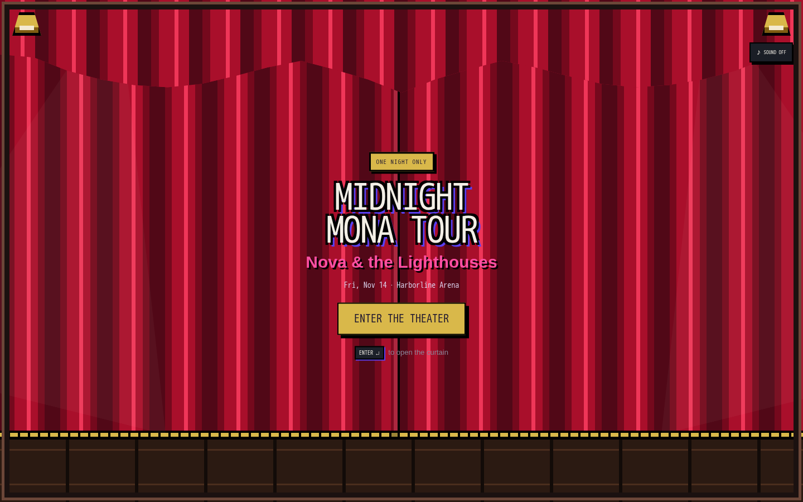
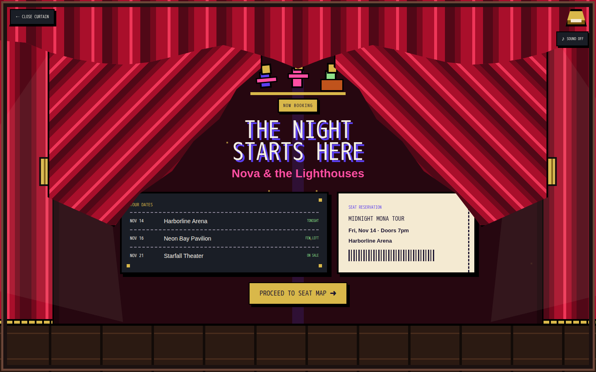
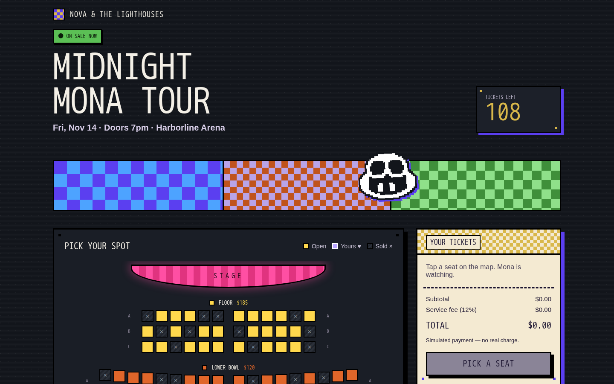
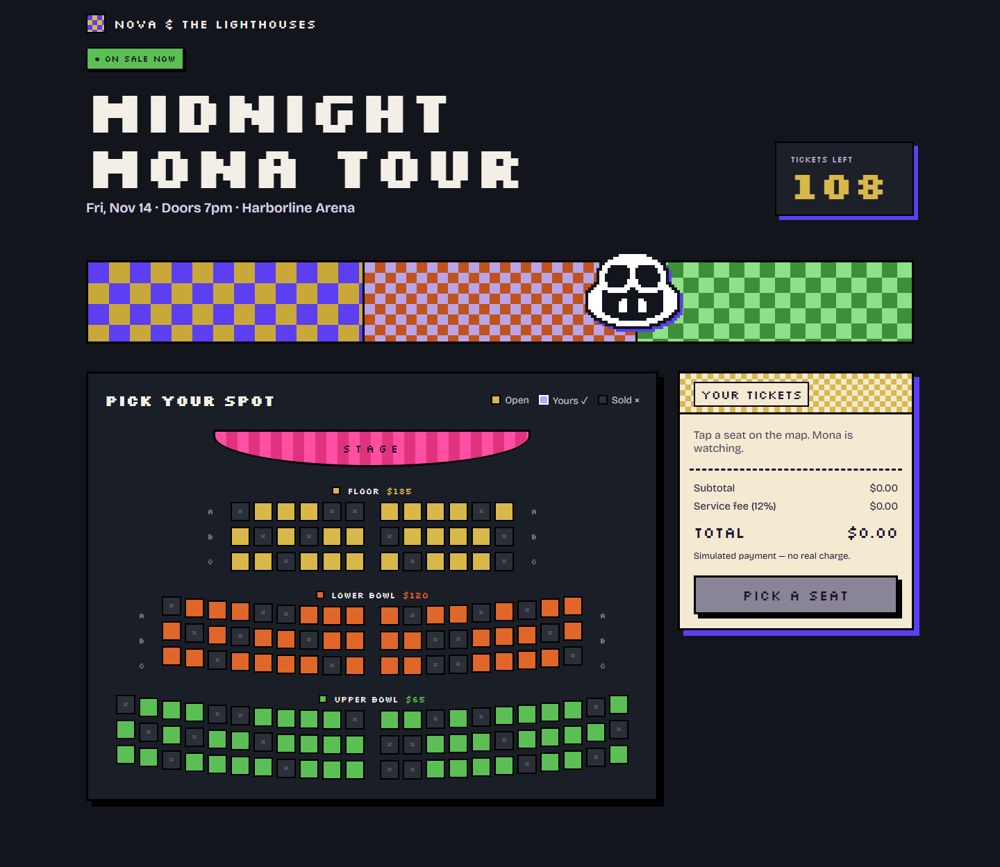
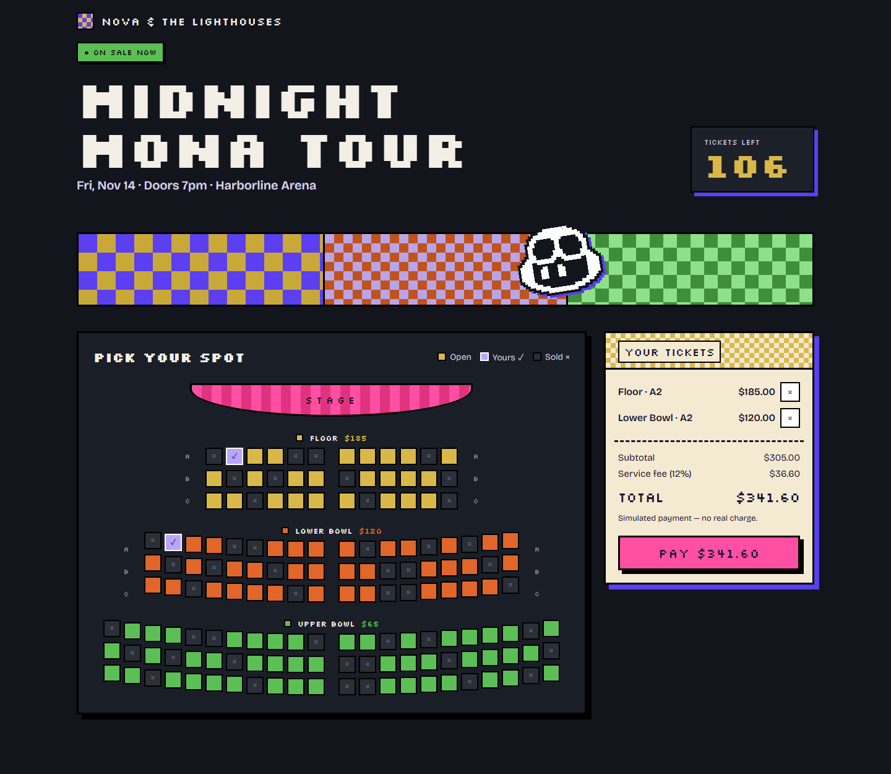
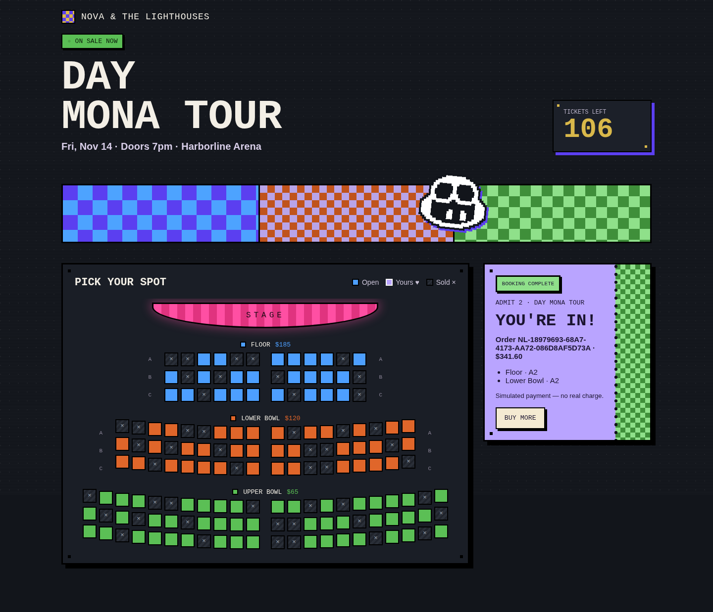
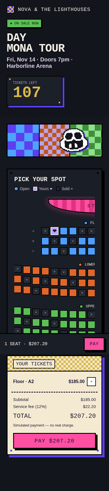

# Nova & the Lighthouses — Midnight Mona Tour

A pixel-art concert ticket-booking app with simulated payments. It uses Vite and TypeScript with no UI framework or backend.

## Quick overview

- Pick seats from a color-coded arena map: Floor ($185), Lower Bowl ($120), or Upper Bowl ($65). Sold seats cannot be selected.
- Enter through a closed pixel-art theater curtain, reveal the tour teaser and reservation ticket, then proceed into seat selection. The intro includes reversible curtains, cursor-reactive spotlights, pixel dust, and optional synthesized 8-bit sound.
- Add or remove seats and see the ticket count, subtotal, 12% service fee, and total update immediately.
- Complete a simulated checkout to get a ticket-style confirmation with an order ID and purchased seats.
- Book on desktop or mobile, with a sticky mobile checkout bar and a horizontally scrollable seat map.

## UI improvements

- Added a full-screen 16-bit theater entrance before seat selection.
- Built closed and open curtain states with a reversible GSAP animation timeline.
- Added a pixel proscenium frame, crimson curtains, gold trim and tassels, wooden floorboards, corner lamps, moving spotlights, and falling pixel dust.
- Added an event marquee with keyboard **Enter** support and an optional synthesized 8-bit sound toggle.
- Added a revealed tour teaser with an animated pixel band, tour dates, and a seat-reservation ticket.
- Added **Close Curtain** and **Proceed to Seat Map** controls so shoppers can move through or reset the experience.
- Preserved reduced-motion behavior, focus management, responsive layouts, and the existing seat-selection flow.

## Demo flow

For the cross-client coding-agent rehearsal, see
[Continuity E2E demo guide](docs/continuity-e2e-demo.md).

### 1. Enter the theater

The experience begins with the curtain closed. Select **Enter the Theater** or press **Enter** to start the show.



### 2. Reveal the tour

The curtains open to reveal the tour teaser, upcoming dates, and reservation ticket. **Close Curtain** reverses the animation.



### 3. Choose seats

Select **Proceed to Seat Map** to continue into the existing interactive arena and checkout experience.



## Run locally

```bash
npm install
npm run dev        # open the printed URL
npm run build      # type-check and build for production
npm run preview    # preview the production build
```

## Files

| File | What it holds |
| --- | --- |
| `src/main.ts` | Theater intro, GSAP timeline, app shell, rendering, state, checkout flow and interaction handling |
| `src/data.ts` | Event details, tiers, prices, fee rate and the seat inventory (with the curved-bowl offsets) |
| `src/mascot.ts` | The pixel mascot (drawn from a character map) and the cursor look-at behaviour |
| `src/style.css` | All styles; colours and fonts are custom properties at the top |

## Booking tickets

Select available seats, review the subtotal and 12% service fee, then click **Pay**. Checkout displays a processing state for approximately 1.5 seconds before confirming the order. Seat changes and repeated payments are blocked during processing.

The confirmation includes a unique order ID, purchased seats, ticket count, and total. **Buy More** returns to shopping; purchased seats stay sold for the current session.

## Demo limitations

Payments are simulated and always succeed. No card information is collected, no payment provider is contacted, and no real charge occurs. Seat inventory and orders exist only in browser memory and reset when the page is refreshed.

## Screenshots

Captured from the running app with Playwright and Chromium.

### Seat map

Browse the three seating tiers and see which seats are open or already sold.



### Selected tickets

Selecting a Floor seat and a Lower Bowl seat brings the total to $341.60, including the 12% service fee.



### Order confirmation

After simulated payment, purchased seats are marked sold and the cart becomes a confirmation ticket.



### Mobile booking

The narrow layout stacks the cart below the scrollable seat map and keeps a checkout bar visible.


