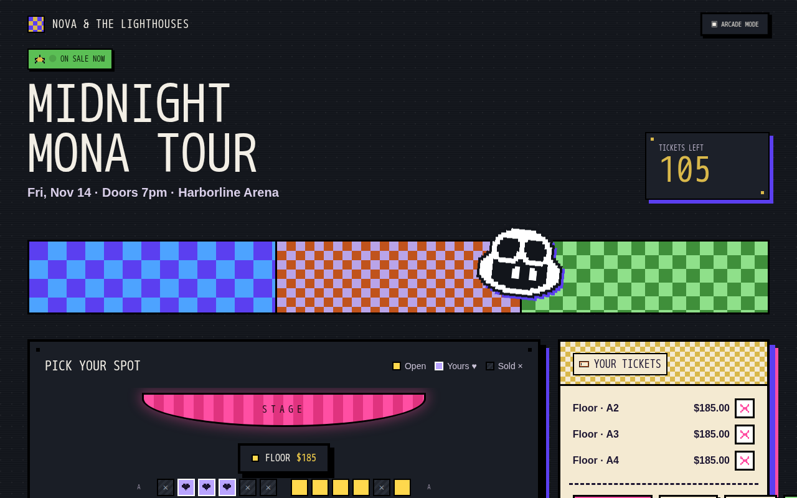
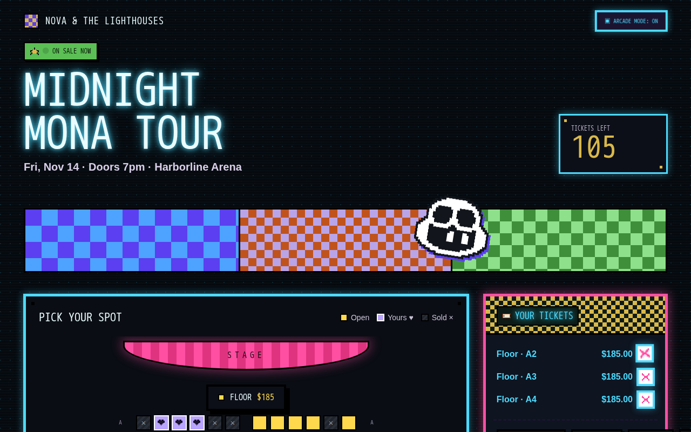
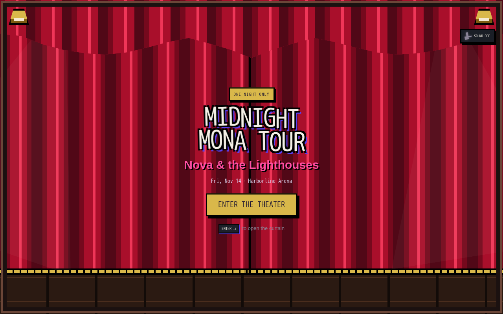
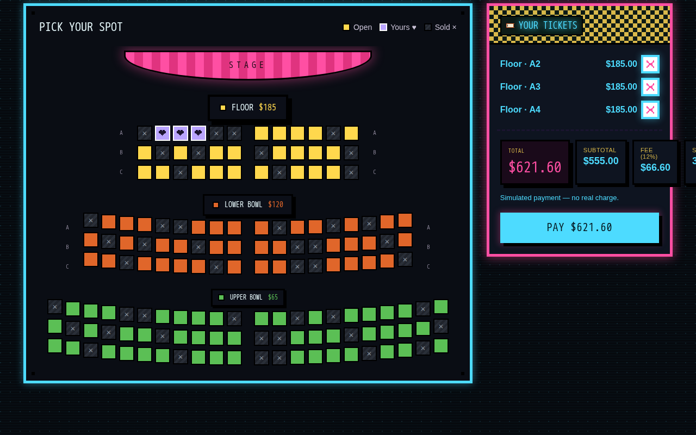
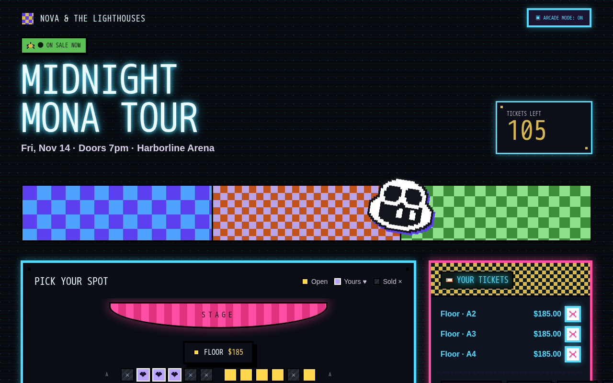
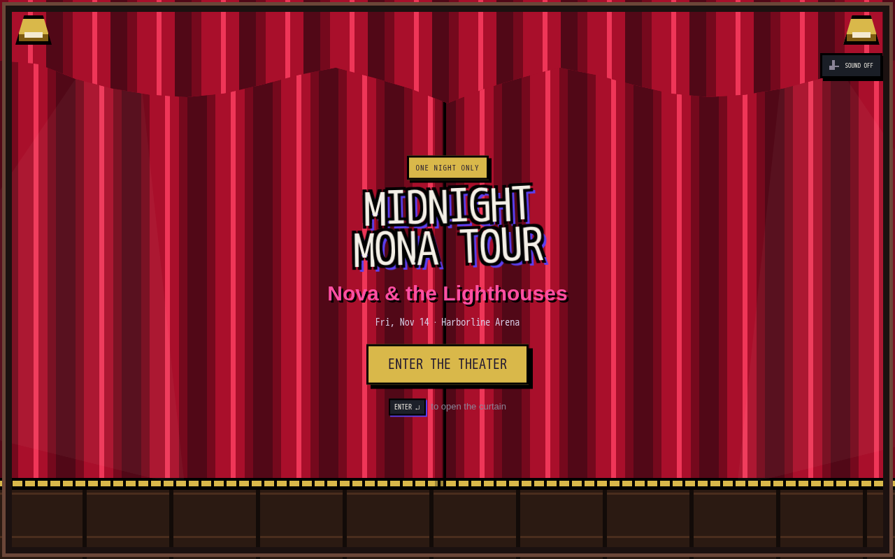

# Nova Sales — 2026 Design Refresh

This documents the five redesign directions approved from the earlier trend
research and mockup preview, now implemented live in the real app (`src/`),
not as throwaway mockup pages. Every change is additive: seat selection,
checkout, the sound toggle, and the theater-curtain intro all keep working
exactly as before.

Screenshots below were captured with Playwright against the running dev
server at 1280×800.

## 1. Amplified neo-brutalism / retrofuturism

Borders on `.panel` and `.cart` went from 3px to 4px, and their single hard
drop-shadow became a **layered** double shadow (e.g. `9px 9px 0 #000,
14px 14px 0 var(--purple)` on the seat-map panel; black + pink on the cart).
Buttons (`.btn`) gained a 3px border and a subtle `translate(-2px, -2px)`
lift on hover, so the whole UI reads bolder and more "stacked" than before,
while staying on the same purple/pink/mustard palette.

## 2. Animated icon set

The pixel icon set added in #7 (`public/assets/icons/{star,ticket,close,
sound-on,sound-off}.svg`) was previously unused in the app. It's now inlined
via `src/icons.ts` (`iconSVG()`) and wired into real UI: the sound toggle
(sound-on/sound-off), the "YOUR TICKETS" cart header (ticket), the "ON SALE
NOW" pill (star), and every seat-removal button (close). Hovering or
pressing a button containing an icon triggers a `scale + rotate` wiggle
keyframe plus a colored `drop-shadow` glow matched to the icon (cyan for
sound-on, pink for close, mustard for star).

## 3. Bento-grid checkout / seat-map panels

The checkout summary (`renderCart()`) no longer lists subtotal/fee/total as
plain rows — it's a CSS grid (`.bento-totals`) with importance-sized tiles:
a large pink TOTAL tile spans both columns, with smaller Subtotal/Fee/Seats
tiles below, each with its own bold border and hard shadow. The seat-map
tier legend (`buildVenue()`) got the same treatment: `.tier-badge` tiles are
sized by ticket price — Floor is the biggest/boldest badge, Upper Bowl the
smallest — so importance maps directly to visual weight.

## 4. Arcade/CRT dark-mode toggle

A new "ARCADE MODE" button in the top bar (`toggleTheme()`) flips
`<html data-theme="arcade">` and persists the choice in
`localStorage['nova-theme']`, so it survives reloads. The arcade variant
leans into the CRT scanline overlay that already existed in `body::before`
(boosted opacity + a slow flicker keyframe) and swaps in neon cyan/pink
accents: outlined glowing borders on panels and buttons, and a neon-cyan
"PAY" button. It respects `prefers-reduced-motion` by disabling the flicker.

## 5. Kinetic pixel typography

The landing/intro title ("MIDNIGHT MONA TOUR" on the curtain screen) is now
built from a `kineticText()` helper that wraps every glyph in its own
`` with a `--i` index. `style.css` staggers a `kinetic-bounce`
keyframe across those spans (`animation-delay: calc(var(--i) * 0.045s)`),
giving the title a continuous bouncing, kinetic-type feel instead of a
static heading. Disabled under `prefers-reduced-motion`.

---

All five directions were implemented directly in `src/style.css`,
`src/main.ts`, and the new `src/icons.ts`; `npm run build` (TypeScript +
Vite) passes with no errors.
